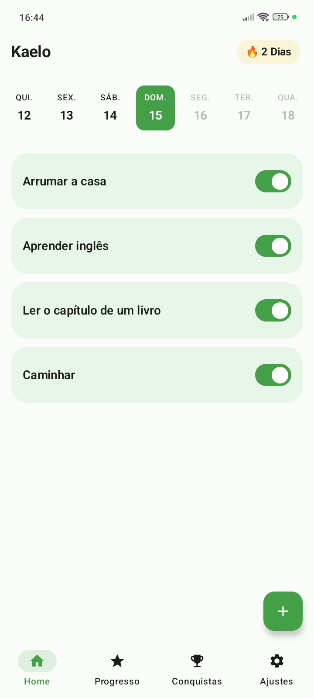
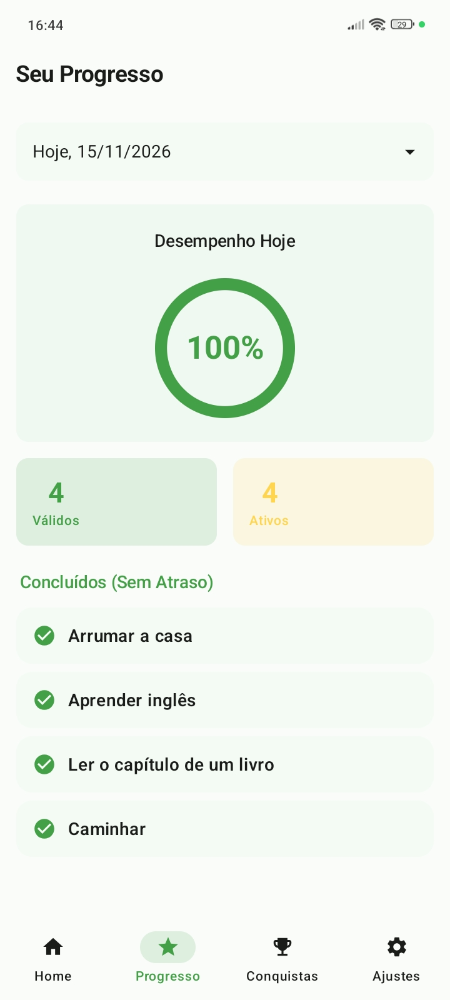
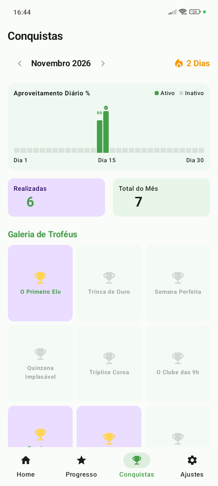
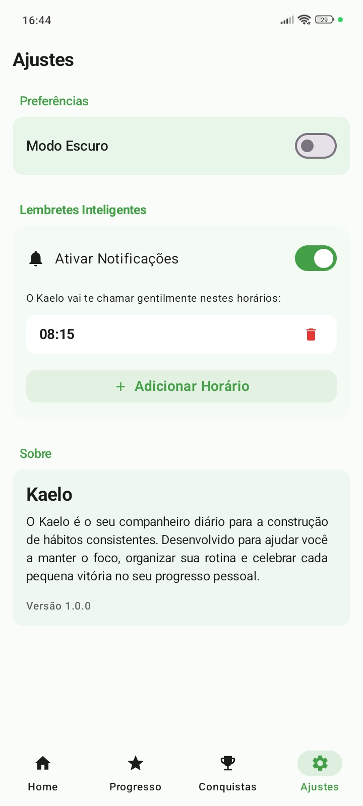

<h1 align="center">
  
   
  Kaelo - O tempo oportuno para o seu próximo elo
</h1>

  
  
  
  

## 📱 Sobre o Kaelo
O **Kaelo** é um aplicativo Android nativo, moderno e 100% persistente, desenvolvido para rastreamento de hábitos diários e visualização de métricas de consistência. Seu nome nasce da fusão entre **Kairós** (o tempo oportuno e de qualidade) e **Elo** (a corrente inquebrável da consistência diária). Em vez de funcionar como uma lista fria de cobranças, o Kaelo valoriza a decisão consciente do usuário de fechar mais um elo no momento oportuno do seu dia, resolvendo a dor da quebra de consistência no meio da semana.

---

## 🚀 Download do Aplicativo

Experimente o Kaelo agora mesmo no seu celular Android!

**Como instalar:**
1. Clique no botão acima para baixar o arquivo `.apk`.
2. No seu celular, abra o arquivo baixado.
3. Se o Android pedir permissão de segurança, clique em "Configurações" e ative "Permitir desta fonte".
4. Clique em "Instalar" e pronto!

---

## ✨ Principais Funcionalidades

- 📈 **Progresso e Estatísticas (Dashboard):** Acompanhe o desempenho semanal em um gráfico de pizza interativo e o histórico mensal em gráficos de barras de 30 dias com micro-tipografia, visualizando facilmente os dias com 100% de aproveitamento.
- ✅ **Checklist Reativo:** Lista de hábitos diários com cards elegantes que garantem alto contraste. Modifique o status de cada meta com micro-interações suaves.
- 📆 **Régua Semanal Interativa:** Navegue pelos dias da semana para visualizar o histórico. Em dias passados, o modo de "Viagem no Tempo" (Somente Leitura) previne alterações retroativas, mantendo a integridade do seu progresso.
- 🏆 **Gamificação e Conquistas:** Ganhe insígnias e troféus baseados no seu desempenho mensal. Os meses encerrados tornam-se um histórico imutável para você celebrar sua jornada.
- 🎨 **Tema Dinâmico Imutável:** Suporte nativo ao Modo Claro e Escuro utilizando a paleta de cores exclusiva (VerdeKairos, VerdeFolha, AmareloAurora e ErroVermelho). O Dynamic Color está desativado para garantir a consistência visual em qualquer versão do Android.

---

## 🛠️ Tecnologias e Arquitetura

O Kaelo foi construído seguindo as melhores práticas do desenvolvimento Android moderno, aplicando os princípios SOLID e Clean Code:

- **Linguagem:** Kotlin 100%
- **UI Toolkit:** Jetpack Compose + Material Design 3
- **Arquitetura:** MVVM (Model-View-ViewModel) + UDF (Unidirectional Data Flow)
- **Injeção de Dependência:** Dagger Hilt
- **Banco de Dados:** Room Database (SQLite) para persistência local offline de hábitos e registros
- **Assincronismo:** Kotlin Coroutines & StateFlow
- **Navegação:** Type-Safe Navigation Compose (Rotas tipadas em Sealed Classes)
- **Armazenamento de Preferências:** Jetpack DataStore Preferences (Tema e Notificações)
- **Gráficos Customizados:** Canvas API nativa do Compose

---

## 📸 Telas do Aplicativo

| Tela Principal (Home) | Progresso Diário | Conquistas Mensais | Ajustes |
| :---: | :---: | :---: | :---: |
|  |  |  |  |

---

## 👨‍💻 Equipe de Desenvolvimento
Projeto desenvolvido por:
- **Carlos Felipe Souza Carvalho** - Desenvolvedor
- **João Pedro Garcia** - Desenvolvedor
- **Sávio José Mouzinho Monteiro** - Desenvolvedor
- **Bianka Rocha da Silva** - Documentação
